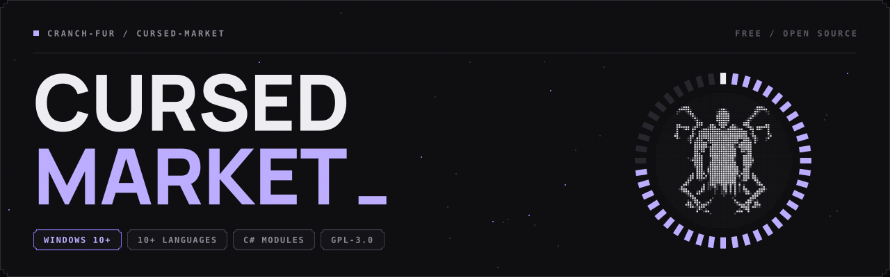
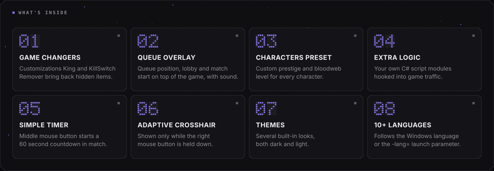

<p align="center">
  
</p>

<p align="center">
  <a href="https://github.com/Cranch-fur/Cursed-Market/releases/latest"><b>Download</b></a>
  &nbsp;&middot;&nbsp;
  <a href="#quick-start">Quick start</a>
  &nbsp;&middot;&nbsp;
  <a href="#launch-parameters">Launch parameters</a>
  &nbsp;&middot;&nbsp;
  <a href="#extra-logic">Extra Logic</a>
  &nbsp;&middot;&nbsp;
  <a href="#troubleshooting">Troubleshooting</a>
  &nbsp;&middot;&nbsp;
  <a href="#building-from-source">Build</a>
</p>

A multifunctional program providing free, temporary access to all in-game privileges: iconic characters, their customization elements, and gameplay modifiers (items, addons, and perks). During gameplay interactions, internet requests are intercepted before reaching the game servers, reducing the risk of penalties for "rule-breaking".

> [!WARNING]
> Changing game traffic is against the Dead by Daylight Terms of Service. You use Cursed Market at your own risk.

<p align="center">
  
</p>

## How it works

Cursed Market starts a local proxy (FiddlerCore) on `127.0.0.1:8888` and registers it as the Windows system proxy. To read HTTPS traffic it creates its own root certificate and asks you to trust it. Game requests that go through the proxy are answered or changed locally, everything else is passed through as is.

When you close the program, the proxy is turned off and Windows proxy settings go back to normal.

## Quick start

1. Download the latest `Cursed.Market.x.x.x.x.zip` from [Releases](https://github.com/Cranch-fur/Cursed-Market/releases/latest) and unpack it to any folder.
2. Run `Cursed Market.exe`. If the Roboto font is missing, the program opens the installer from the `Requirements` folder, install it and run the program again.
3. Accept the root certificate prompt on first start.
4. Pick the options you need and press **START**.
5. Launch the game. "Platform Running" in Settings > Debug Information shows your platform once the game logs in.

## Main features

| Option | What it does |
| --- | --- |
| Queue Position Overlay | Small always-on-top window with queue position, "lobby found" and "match starting". A notification sound can be picked in Settings. |
| Adjust Currencies Amount | Shows custom Bloodpoints, Iridescent Shards and Auric Cells amounts. Visual only. |
| Enable Temporary SaveFile | Replaces character progression (levels, perks, add-ons) with a full save from the API for the session. Required for Custom Characters Preset. |
| Custom Characters Preset | Sets prestige and bloodweb level per character from `Characters Preset\CharactersPreset.json`. Can be updated from the API in Settings. |
| Disable Game Changers | Turns off Customizations King and KillSwitch Remover. |
| Only Unlock DLC's | Unlocks DLC content only instead of the full inventory. |

**Game Changers.** Customizations King brings back customization sets that are hidden until a release date. KillSwitch Remover brings back items that the developers turned off because they were bugged. Their status is shown on the main window.

**Themes.** Default, Legacy, Dark Memories, Saints Row, Dracula and Christmas, switched in Settings.

**Languages.** English, Arabic, Armenian, Chinese, French, German, Hindi, Italian, Japanese, Korean, Portuguese, Russian, Spanish, Thai, Turkish and Ukrainian. The program follows the Windows display language, use `-lang=` to force another one.

### Simple Timer

Can't always measure the required time interval correctly, missing by just a few seconds? Launch the program with `Cursed Market - Timer Feature.bat` or with the `-timerToggleFeature` parameter.

During a match press the middle mouse button to start a 60 second countdown. You don't have to wait until it finishes, press the button again to restart it.

### Adaptive Crosshair

The crosshair is shown only while the right mouse button is held down and hides when it's released. Launch the program with `Cursed Market - Crosshair Feature.bat` or with the `-crosshairToggleFeature` parameter. Crosshair style and opacity are set in the crosshair settings window, custom images can be put into the `Crosshairs` folder as `Crosshair 01.png` to `Crosshair 03.png`.

## Launch parameters

Add them to the shortcut target or to a `.bat` file, for example `"Cursed Market.exe" -lang=en -noAntiKillSwitch`.

| Parameter | Effect |
| --- | --- |
| `-lang=xx` | Interface language, two letter code (`en`, `ru`, `de`, ...). |
| `-offline` | Doesn't contact the API, uses data built into the program. |
| `-noCustomizationsKing` | Keeps Customizations King off. |
| `-noAntiKillSwitch` | Keeps KillSwitch Remover off. |
| `-noCharacterData` | Uses built-in character and bloodweb data instead of downloading it. |
| `-forceClearContentCache` | Clears the game's cached `catalog.json` and `itemsKillswitch.json` every time **START** is pressed. |
| `-timerToggleFeature` | Enables [Simple Timer](#simple-timer). |
| `-crosshairToggleFeature` | Enables [Adaptive Crosshair](#adaptive-crosshair). |

## Extra Logic

Every `*.csx` file placed into the "Extra Logic" folder next to "Cursed Market.exe" is a module (sub-folders are reserved for shared files included with `#load`). Several modules can hook the same event, they run in alphabetical order of file names (prefix names with numbers to control the order).

Extra Logic is off by default: hold <kbd>Shift</kbd> while pressing **START** to open the Extra Logic window. It lists all modules with checkboxes; selecting a module shows its summary: author's description plus behaviour detected by an automatic code scan (potentially dangerous modules are marked with `[!]`). Nothing is ticked by default. Your ticks are remembered; new or changed files (including files they `#load`) appear unticked and marked "(new)" / "(changed)" until you review them. Full documentation: "Extra Logic Guide.txt" in the "Extra Logic" folder.

Describe your module with a header at the top of the file:

```csharp
// @name        Response Logger
// @author      Cranch
// @version     1.0
// @description Writes URLs of game responses to Extra Logic\Logs.
// @description Doesn't change any traffic.

OnBeforeResponse(session =>
{
    if (IsGameSession(session))
        Log(session.fullUrl);
});
```

<details>
<summary><b>Available to modules</b></summary>

| Name | Description |
| --- | --- |
| `OnBeforeRequest`, `OnBeforeResponse`, `OnAfterSessionComplete`, `OnStop` | Event handlers. They are protected with try/catch and removed when the proxy stops. |
| `IsGameSession(session)` | True if the session belongs to game servers. |
| `Log`, `Notify`, `ShowMessage` | Write to `Extra Logic\Logs`, show a Windows notification or a message box. |
| `Storage`, `SaveStorage()`, `UpdateStorage(...)` | Persistent JSON per module. Use `UpdateStorage` when changing it inside proxy handlers, they run in parallel. |
| `UserId`, `MatchId`, `IsInQueue`, `IsInMatch`, `PlayerRole`, `GamePlatform` | Current game state. |

Old-style modules (`BeforeRequest.csx` etc.) that subscribe to `FiddlerApplication` directly keep working.

</details>

## Troubleshooting

**No internet after closing the program.** Open Settings and press **Disable Proxy**, or turn off "Use a proxy server" in Windows Settings > Network & internet > Proxy.

**Nothing changes in game, "Platform Running" stays "None".** Game traffic doesn't reach the proxy.
- Start Cursed Market before the game, not after.
- In Windows Settings > Network & internet > Proxy turn off "Use setup script". While it's on, Windows ignores the Cursed Market proxy. VPN and antivirus apps often turn it on.
- While the program is running, "Use a proxy server" should show `127.0.0.1:8888`. If it shows something else, another program (VPN, Fiddler, antivirus) changes it.
- In Settings press **Clear Fiddler Certificates**, restart the program and accept the certificate again.

**Antivirus warning.** The program installs a root certificate, changes system proxy settings and reads game traffic, which is what antivirus heuristics look for. The source code is in this repository, you can [build it yourself](#building-from-source).

**Where data is stored.**
- Settings: `HKEY_CURRENT_USER\SOFTWARE\Cursed Market`
- Root certificate: `%AppData%\Cursed Market`
- **Reset Cursed Market Settings** in Settings removes both.

## Building from source

Requirements: Windows, Visual Studio 2022 with the ".NET desktop development" workload and the .NET Framework 4.8.1 Developer Pack.

1. Clone the repository and open `Cursed Market.sln`.
2. Restore NuGet packages (Visual Studio does it on build).
3. Build the `Release` configuration (`AnyCPU`, `x64` or `ARM64`). Libraries are embedded into `Cursed Market.exe` with Costura.Fody, so the exe works on its own.

Third-party libraries that aren't on NuGet (FiddlerCore, BCMakeCert, Telerik.NetworkConnections and others) are in the `Libs` folder.

## License

[GNU General Public License v3.0](LICENSE.txt)
